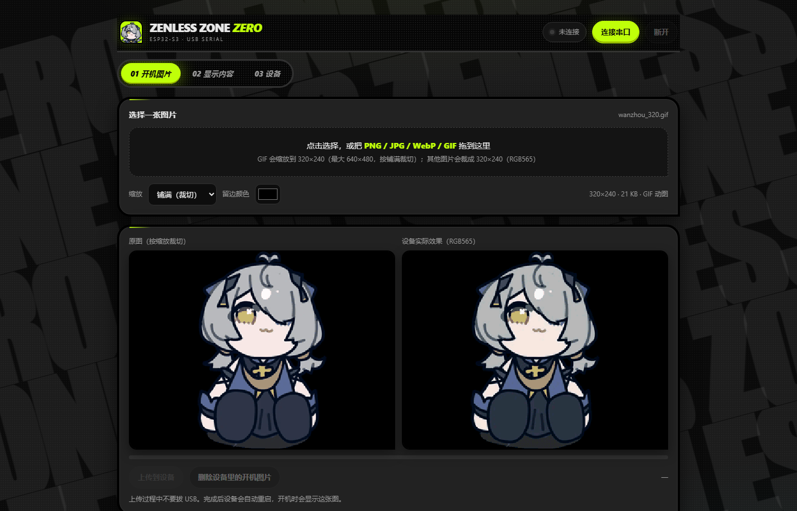
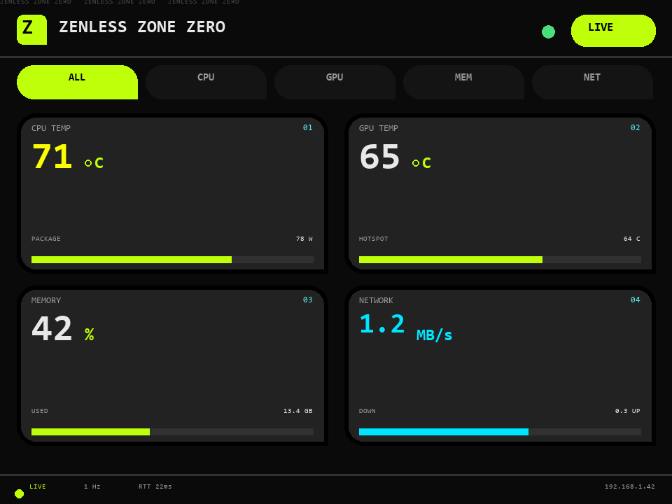
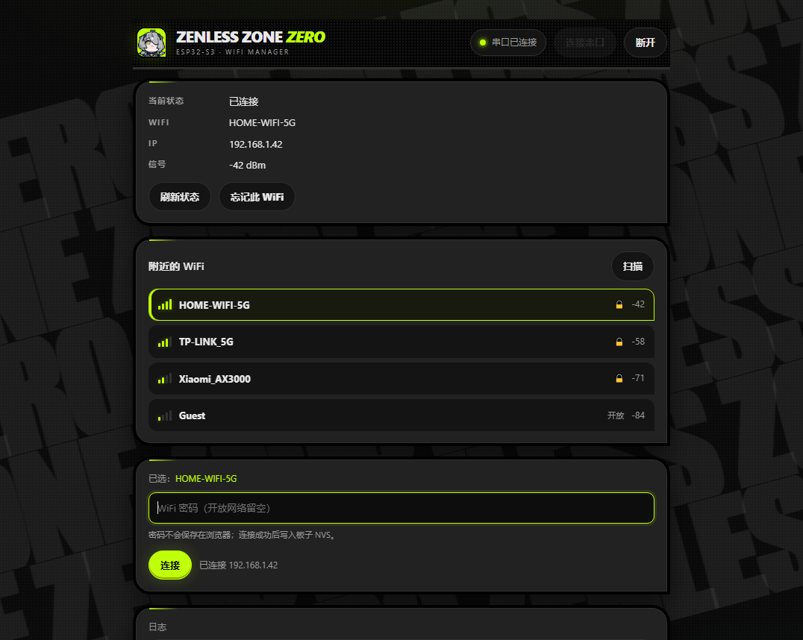

# ESP32-S3 电脑状态副屏

[](https://github.com/lsaa4/esp32-hardware-monitor/actions/workflows/build.yml)

一块 ESP32-S3 + ST7789 SPI 彩屏，把电脑的 CPU / GPU 温度、负载、频率、功耗，以及内存、硬盘、网速、电池做成一块**每 10 秒自动翻页的实时副屏**。界面是「绝区零 / ZZZ」风格：近黑底、荧光绿、缺角卡片、2×2 仪表盘。

数据来自 PC 上的 [LibreHardwareMonitor](https://github.com/LibreHardwareMonitor/LibreHardwareMonitor)（下称 LHM）的 Web 接口，通过局域网 HTTP 拉取，**PC 端不用装任何客户端或驱动**。

## 效果

<p align="center">
  
</p>
<p align="center"><em>Web Serial 控制台：上传开机图、选择显示页、串口配网；顶部是挽昼（小碗粥）头像。</em></p>

<table align="center">
  <tr>
    <td align="center"><br><sub>设备端 320×240 · 界面渲染（3× 放大）</sub></td>
    <td align="center"><br><sub>自定义开机图 · 挽昼（小碗粥） · 320×240 GIF</sub></td>
  </tr>
</table>

<p align="center">
  <br>
  <sub>串口配网页（界面示意）：扫描 / 选网 / 输入密码；密码只在连接成功后写入板子 NVS</sub>
</p>

*绝区零风格（代码里的 `UI_STYLE 5` / `ui_zzz.h`）：黑底 + 荧光绿 + 缺角卡片，2×2 卡片 + 顶部胶囊页签。*

> 仓库内不含任何 WiFi 账号或密码。首次使用请复制 `secrets.example.h` 为 `secrets.h` 填入自己的 WiFi，或烧录后用 `wifi_manager.html` 串口配网。

---

## 功能

- **绝区零风格仪表盘**：`#0A0A0A` 近黑底 + `#BFFF09` 荧光绿 + 白字 + 灰标签；卡片 2px 黑框、`#222` 内层、右下直角
- **5 个胶囊页签**：ALL / CPU / GPU / MEM / NET，每页 2×2 卡片，每 10 秒轮播；可在 WebUI 里只保留其中几页
- **自定义开机图片**：WebUI 上传一张 320×240 图片，存进 9.9 MB ffat，开机逐条展开显示；支持 PNG / JPG / WebP / GIF（GIF ≤640×480，自动缩放到 320×240 后开机循环约 3 秒）
- **MCU 顶部滚动背板**：7px 高 5×7 点阵 `ZENLESS ZONE ZERO`，20 px/s 循环，不占卡片区域
- **WebUI 控制台**：`webui.html` 通过 USB 串口上传图片、勾选显示页，不用重烧固件；绝区零风格，和配网页共用 `zzz_theme.css`，背板是官网 wiki 的 `ZENLESS ZONE ZERO` 6 行大字，铺满整屏、斜向无缝慢移；顶部用挽昼（小碗粥）头像，刷新保留缩放 / 留边色 / 页签 / 页草稿，页掩码连接后自动保存；已授权的串口会在刷新后自动恢复；手动点「断开」后刷新不会自动连，再点「连接串口」才恢复自动；上次上传的开机图预览也会从浏览器 IndexedDB 恢复
- **翻页过渡**：黑色扫描线 + 荧光绿边从左到右擦屏（约 0.12 秒），不白闪
- **1 秒刷新**，卡片只重绘数值区；页脚显示 `LIVE / 1 Hz / RTT / IP`
- **自动发现数据源**：PC 换 IP、换机器都不用重新烧录
- **串口配网**：Chrome / Edge 打开 `wifi_manager.html`，扫描 → 选网 → 输密码，账号存进 NVS
- **状态灯**（板载 WS2812，GPIO48）：无 WiFi 蓝色呼吸 / 有 WiFi 无数据红色慢闪 / 正常按 CPU 温度绿→黄→红呼吸 / 翻页白闪
- **不写死硬件型号**：CPU / GPU 名字从 LHM 的传感器树里读，AMD / Intel、NVIDIA / AMD 都能用

## 五个页签

| 页签 | 内容 |
|---|---|
| ALL | CPU / GPU 温度、负载、内存、网络概览 |
| CPU | CPU 温度、负载、平均频率、封装功耗 |
| GPU | GPU 温度 / 热点 / 显存温度、负载、显存、功耗 |
| MEM | 内存用量、最多 2 块硬盘的温度 / 占用、内存条温度 |
| NET | 下行 / 上行速率、电池电量 / 电压 / 健康度、RTT |

> WebUI 里可以只启用其中几页；只开一页时不会每 10 秒重复擦屏。原来的每线程柱状图 / 每盘读写速率在卡片版里收起来了，需要可以再加。

## 硬件

| 物料 | 说明 |
|---|---|
| ESP32-S3 开发板 | 16 MB Flash + 8 MB OPI PSRAM（N16R8），板载 CH343 串口 |
| SPI 彩屏 | ST7789，320×240，8 针（VCC / GND / SCL / SDA / RES / DC / CS / BLK） |
| 杜邦线 | 8 根 |

### 接线

| 屏幕引脚 | ESP32-S3 |
|---|---|
| VCC | 3V3 |
| GND | GND |
| SCL / SCLK | GPIO21 |
| SDA / MOSI | GPIO47 |
| RES / RST | GPIO45 |
| DC | GPIO40 |
| CS | GPIO41 |
| BLK / BL | GPIO42（高电平点亮） |

- 走硬件 SPI（FSPI），**80 MHz**：满屏填充实测 20.3 ms ≈ 49 fps（20 / 40 / 80 MHz 分别为 15 / 28 / 49 fps）。ESP32-S3 的 SPI 是整数分频，62.5 MHz 会被抹成 40 MHz，所以直接上 80；杜邦线太长或质量差时降回 40 MHz。
- 屏幕原生 240×320 竖屏，代码里 `setRotation(3)` 转成 320×240 横屏。

## 快速开始

### 1. PC 端：启动数据源

1. 从 [LHM Releases](https://github.com/LibreHardwareMonitor/LibreHardwareMonitor/releases) 下载并解压（不要下载源码包）。
2. 把本仓库 `pc/` 下的三个文件复制进 LHM 解压目录：
   ```
   start-monitor.bat
   lhm_beacon.ps1
   lhm_beacon.vbs
   ```
3. 右键 `start-monitor.bat` → **以管理员身份运行**。它会：
   - 把 TCP 8085 加进 Windows 防火墙白名单
   - 以管理员权限启动 `LibreHardwareMonitor.exe`（读 CPU 温度等传感器必须要管理员）
   - 后台启动 UDP 8099 广播（供 ESP32 自动发现）
4. **首次使用**需要在 LHM 菜单里打开 Web 服务：
   ```
   Options → Remote Web Server → Run        （端口 8085）
   ```
   浏览器访问 <http://127.0.0.1:8085/data.json>，能看到一大段 JSON 就成功了。

### 2. 编译

Arduino IDE 或 arduino-cli 均可。板子参数**必须完全一致**：

```
开发板     : ESP32S3 Dev Module
Flash Size : 16MB
PSRAM      : OPI PSRAM
Partition  : 16M Flash (3MB APP/9.9MB FATFS)   → app3M_fat9M_16MB
USB CDC On Boot : Disabled（默认值，千万别开）
```

`USB CDC On Boot` 开了以后 `Serial` 会被重定向到原生 USB 口，CH343 口将看不到任何日志。

依赖 **ArduinoJson v7 + AnimatedGIF 2.2.3**（`libraries/AnimatedGIF` 已随仓库提供）。显示部分用的是本仓库自带的 `TFT_hal.h`，**不需要装 TFT_eSPI**。

```powershell
arduino-cli core install esp32:esp32@3.3.12
arduino-cli lib install ArduinoJson
arduino-cli lib install AnimatedGIF@2.2.3

arduino-cli compile --fqbn "esp32:esp32:esp32s3:FlashSize=16M,PSRAM=opi,PartitionScheme=app3M_fat9M_16MB" `
  --libraries libraries `
  firmware/esp32_monitor_hal
```

不想在本地装工具链也可以：每次 push 后 CI 会编译一遍，产物在 Actions 页面对应的 run 里（Artifacts → `firmware-<sha>.zip`，含 app / bootloader / partitions 三个 bin）。

WiFi 二选一：

```powershell
# 方式 A：编译期写死（文件不会被提交）
copy firmware\esp32_monitor_hal\secrets.example.h firmware\esp32_monitor_hal\secrets.h
# 然后编辑 secrets.h 填入 SSID / 密码
```

方式 B 见下面的「配网」一节。

### 3. 烧录

> 视频观众直接看这里：从 [Releases](https://github.com/lsaa4/esp32-hardware-monitor/releases/latest) 下载现成 bin，不用装 Arduino IDE。

| 场景 | 下载文件 | 烧录地址 | 会清掉 WiFi / 开机图？ |
|---|---|---|---|
| **第一次烧 / 新板子** | `esp32_monitor_hal.ino.merged.bin`（16 MB 全量） | **`0x0`** | 会，烧完重新配网、重新传开机图 |
| **已经装过旧版，只升级** | `esp32_monitor_hal.ino.bin`（约 1.2 MB） | **`0x10000`** | 不会，保留 NVS 和 ffat |

**第一次烧 / 新板子**：

```powershell
esptool --chip esp32s3 --port COM5 --baud 921600 write-flash 0x0 esp32_monitor_hal.ino.merged.bin
```

**只升级程序**：

```powershell
esptool --chip esp32s3 --port COM5 --baud 921600 write-flash 0x10000 esp32_monitor_hal.ino.bin
```

- 端口按设备管理器里的 **CH343** 口改，不一定是 `COM5`
- 串口要用板子上 **CH343** 那个 Type-C 口，不是标着 `USB` 的原生口
- esptool v4 是 `write_flash`（下划线），v5 是 `write-flash`
- **不要** `erase-flash`，也不要把 app 写到 `0x0`
- 全量烧 `0x0` 会清 NVS/ffat，所以第一次烧完要重新配网、传开机图；以后升级只烧 `0x10000`

不想用命令行，可以用乐鑫 **Flash Download Tool**：选 `ESP32-S3` / `Develop` / `UART`，文件按上表选，地址分别填 `0x0` 或 `0x10000`，COM 选 CH343，波特率 `921600`，点 `START`。连不上就按住 `BOOT`、点一下 `RST`、松开 `BOOT` 再点 `START`。

> Release 里的 `esp32_monitor_hal.ino.bin` 是 app；仓库里的 `firmware/build/esp32_monitor_hal_marquee.bin` 是同一版的本地副本。早期 v1.2.x 的文件名/版本号带 `interk` 是历史命名；当前统一用 `zzz`。

### 4. 配网（不用重新烧录）

Chrome / Edge 打开 `firmware/esp32_monitor_hal/wifi_manager.html`：

1. 点「连接串口」→ 选 CH343 的 COM 口（115200）
2. 点「扫描」，等约 3 秒
3. 选中目标 WiFi → 输密码 → 「连接」
4. 成功会显示 `已连接 IP=192.168.x.x`

板子把账号存进 NVS，下次开机自动连。换 WiFi 重复上面步骤即可。

> 没有 `secrets.h` 时，开机后有 12 秒的配网窗口；错过了也没关系，界面出来后随时可以配。

> 双击 html 如果提示浏览器不支持 Web Serial，在该目录执行 `python -m http.server 8000`，
> 再打开 <http://localhost:8000/wifi_manager.html>。

## 自定义开机图片 / 显示内容

新固件带一个 WebUI 控制台：`firmware/esp32_monitor_hal/webui.html`。它和 `wifi_manager.html` 共用同目录的 `zzz_theme.css`（黑底 + 荧光绿 + 缺角卡片 + 胶囊页签）和 `wanzhou_avatar.png`（顶部挽昼（小碗粥）头像），**四个文件要放在同一目录**，单独拷 HTML 会掉样式和头像。背板取官网 wiki 的 `pc-page-bg.png` 文字：6 行 `ZENLESS ZONE ZERO`，每行 4 个副本无缝循环，旋转 -15°，Impact 压缩粗体，`clamp(160px, 18vw, 260px)`，`400s / 480s` 反向慢移，`7%` 白；`prefers-reduced-motion` 下自动停。界面偏好存浏览器 `localStorage`，页掩码存设备 NVS；WiFi 密码不会存浏览器。

### 烧录

```powershell
esptool --chip esp32s3 --port COM5 --baud 921600 write-flash 0x10000 firmware\build\esp32_monitor_hal_marquee.bin
```

只写 app 区，**保留 NVS 里已配好的 WiFi**。第一次启动会格式化 9.9 MB 的 ffat 分区（约 1–2 秒），之后不会重复。

### 使用

1. Chrome / Edge 打开 `webui.html`（双击不行就 `python -m http.server 8000`，再开 <http://localhost:8000/webui.html>）。
2. 点「连接串口」→ 选 CH343 的 COM 口（115200）。
3. **开机图片**：选 PNG / JPG / WebP → 调「铺满 / 完整」和留边色 → 上传（约 15–20 秒）→ 重启后生效。
4. **显示内容**：勾选要轮播的页（ALL / CPU / GPU / MEM / NET）→ 保存，立即生效，不用重启。

图片在设备里会统一转成 320×240 RGB565（153,600 字节），加 16 字节头存到 ffat 的 `/boot.img`，上传时按 2 KB 分块 + 每块 ACK + CRC32 校验。开机时先校验 CRC，再分 8 条推屏（约 100 ms 的展开效果）。

> 图片只覆盖开机等待 WiFi 的那十几秒；进仪表盘时用现有的扫描线过渡擦掉。仪表盘壁纸不在这一版范围。
>
> 显示内容目前是**页级**选择（ALL / CPU / GPU / MEM / NET），不是页内每个传感器的开关。配置存在 NVS 的 `pmask` 里，后续重构 UI 时可以继续用 `gPageMask` / `gPageList`。

### 新增的串口命令

| PC → 板子 | 板子 → PC | 说明 |
|---|---|---|
| `INFO` | `#INFO {"fw":"…","mask":31,"img":true,"free":…}` | 固件 / 页掩码 / 图片状态 |
| `CFG?` | `#CFG {"mask":31}` | 读页掩码 |
| `CFG <mask>` | `#OK {"mask":2}` | 写页掩码（1=ALL 2=CPU 4=GPU 8=MEM 16=NET） |
| `IMG?` | `#IMG {"ok":true,…}` | 查开机图片 |
| `IMG B <bytes> <crc>` | `#OK` | 开始上传，打开 `/boot.tmp` |
| `IMG D <n>` | `#READY`，PC 发 n 字节，板子回 `#OK` | 分块写 flash |
| `IMG E` | `#OK` | 校验 CRC，替换 `/boot.img` |
| `IMG A` / `IMG DEL` | `#OK` | 中止 / 删除 |
| `REBOOT` | `#OK` | 重启 |

## 工作原理

```
┌──────────────┐   HTTP GET /data.json    ┌───────────────┐
│ LibreHardware│ ◄─────────────────────── │  ESP32-S3     │
│ Monitor :8085│                          │  (每 1 秒)    │
└──────┬───────┘                          └───────┬───────┘
       │                                          │
       │  UDP 广播 :8099                          │ SPI 80MHz
       │  "LHM|<ip>|8085|<主机名>"  每 2 秒        ▼
       └─────────────────────────────────►  ST7789 320×240
```

**数据解析**：LHM 的 `data.json` 是一棵树（根 → 电脑名 → 硬件 → 分组 → 传感器）。代码只按传感器的 `Text` 名字和 `Value` 的单位（`°C` / `%` / `MHz` / `W` / `B/s`）匹配，不依赖数组下标，所以换 CPU / 显卡不用改代码。

>`data.json` 大约 30–60 KB，ArduinoJson 默认嵌套上限 10 层会报 `TooDeep`，代码里放宽到了 40 层。

**数据源自动发现**，按顺序尝试：

1. NVS 里上次成功的 IP（探测 1.5 秒）
2. 编译时的兜底地址 `PC_HOST`，默认 `192.168.137.1`（Windows 移动热点 / ICS 的固定网关，探测 1.2 秒）
3. 监听 UDP 8099 广播，最长 8 秒，同网段优先，收到后探测 2.5 秒

找到后写入 NVS。连续 5 次拉取失败（约 5 秒）会重新走一遍发现流程，所以 PC 换 IP 也能自己恢复；WiFi 断开时不会白跑这趟发现，等 WiFi 恢复后自动补一次。

**为什么不用 TFT_eSPI**：TFT_eSPI 直接操作 SPI 外设寄存器，而 arduino-esp32 3.x 的 `SPIClass::begin()` 会延迟清零这些寄存器，实测 `tft.init()` 卡死、或初始化成功但推不出像素（白屏）。`TFT_hal.h` 保留了 TFT_eSPI 的类名和方法签名，底层改用 `SPIClass::writeBytes()`，再配一套 4 bit 抗锯齿字模。

## 串口配网协议

`wifi_manager.html` 通过 Web Serial 发命令，板子用 `#TAG {json}` 回包，115200 8N1。

| PC → 板子 | 板子 → PC |
|---|---|
| `STATUS` | `#STATUS {"connected":true,"ssid":"...","ip":"...","rssi":-59}` |
| `SCAN` | `#SCAN {"nets":[{"s":"SSID","r":-62,"e":1,"a":3}]}` |
| `WIFI <ssid>\t<密码>` | `#OK {"ip":"192.168.1.23"}` 或 `#ERR {"msg":"connect failed"}` |
| `FORGET` | `#OK {"msg":"forgotten"}` |

`SCAN` 返回的 `e`：0 = 开放网络，1 = 加密；`a` 是 `wifi_auth_mode_t` 原始值。

## 目录结构

```
.
├─ README.md
├─ LICENSE
├─ 更新说明.md
├─ .gitignore
├─ firmware/
│  ├─ esp32_monitor_hal/          # Arduino 要求目录名与 .ino 同名
│  │  ├─ esp32_monitor_hal.ino    # 主程序：抓取、解析、UI 调度、配网
│  │  ├─ TFT_hal.h                # ST7789 驱动 + 4bit 抗锯齿文字（替代 TFT_eSPI）
│  │  ├─ font_aa.h                # 字模数据（ASCII 32–126，4 个字号）
│  │  ├─ ui_zzz.h                # 绝区零风格 2×2 卡片仪表盘 + 顶部 7px 滚动背板
│  │  ├─ boot_image.h             # 开机图片/GIF 加载 + 串口上传协议
│  │  ├─ display_config.h         # 显示页选择（NVS 掩码）
│  │  ├─ webui.html               # 控制台：上传图片 / 勾选显示页
│  │  ├─ wifi_manager.html        # Web Serial 配网页
│  │  ├─ zzz_theme.css           # 两个网页共用的绝区零主题
│  │  ├─ wanzhou_avatar.png      # 网页顶部挽昼（小碗粥）头像
│  │  └─ secrets.example.h        # WiFi 配置模板，复制为 secrets.h 使用
│  └─ build/
│     └─ esp32_monitor_hal_marquee.bin  # 现成固件 v1.3.2（GIF 自动缩放）
├─ libraries/
│  └─ AnimatedGIF/                # GIF 解码库 2.2.3（源码随仓库）
├─ pc/
│  ├─ start-monitor.bat           # 提权、放行防火墙、启动 LHM + 广播
│  ├─ lhm_beacon.ps1              # UDP 8099 广播本机 IP
│  └─ lhm_beacon.vbs              # 无窗口启动上面的 ps1
├─ docs/
│  ├─ demo-webui.png              # WebUI 控制台效果图
│  ├─ demo-wifi.png               # 串口配网页效果图
│  ├─ demo-mcu.png                # 设备端 320×240 界面渲染
│  └─ demo-boot.gif               # 自定义开机图示例
└─ .github/workflows/build.yml    # push / tag 时自动编译固件
```

## 常见问题

**屏幕显示 PC OFFLINE**

1. LHM 在运行吗？菜单里 Web 服务开了吗？本机 <http://127.0.0.1:8085/data.json> 能打开吗？
2. 板子和 PC 在同一个路由器 / 同一个热点下吗？访客网络和 AP 隔离会导致互相访问不了。
3. 防火墙放行了吗？换端口后要重跑一次 `start-monitor.bat`。
4. 关掉 LHM 里用不到的传感器（主板、部分硬盘、网卡）能让 `data.json` 小很多，解析更快。

**扫不到 WiFi / 连不上**

- ESP32-S3 **只支持 2.4 GHz**，5 GHz 热点扫不到也连不上。
- Windows 移动热点：认证方式是 WPA2/WPA3 混合，代码里已按「先 WPA2 关 PMF，失败再 WPA3」处理（开机和串口配网都是两段式）；另外热点没有设备连接时会自动关闭，先确认它还开着。
- 密码输错不会写进 NVS（连接成功才保存），板子会继续用原来的账号，网页上会显示失败原因（如 `4WAY_HANDSHAKE_TIMEOUT` = 密码错、`NO_AP_FOUND` = 信号/信道问题）。要换网或清掉已保存的账号，用网页上的「忘记此 WiFi」。

**白屏 / 花屏**

- 四个板子参数必须和上面完全一致（16 MB / OPI PSRAM / app3M_fat9M_16MB / CDC 关）。
- 检查接线，尤其是 RST(45)、DC(40)、CS(41) 有没有接错。
- 先把 `TFT_FREQ` 降到 40 MHz 或 20 MHz（`TFT_hal.h`）；杜邦线太长也会花屏。

**串口没有日志**

用的是 CH343 口吗？`USB CDC On Boot` 是不是被打开了？波特率 115200。

**中文显示成问号**

字模只覆盖 ASCII 32–126，界面文字必须用英文。要中文得自己换 `font_aa.h` 里的字模数据。

## 已知限制

- 只支持 2.4 GHz WiFi。
- 界面仅支持 ASCII（字模是 ASCII 95 字符，字号只有 7 / 11 / 19 / 40 px 四档）。
- 最多显示 2 块硬盘、2 根内存条。
- 全量刷写 `merged.bin` 会清空 NVS 和 ffat，WiFi / 开机图片都需要重新配置。
- LHM 读传感器需要管理员权限，普通权限下很多温度值是空的。
- 仅在 Windows + LibreHardwareMonitor 上验证过；LHM 的 `data.json` 结构变了就需要同步改解析。
- 开机图片固定 320×240（RGB565），只用于开机等待画面，不是仪表盘壁纸；全量刷写会清掉。
- 卡片版是 2×2 总览，不再显示每线程柱状图 / 每盘读写速率；需要的话可以在 CPU / MEM 页再加。
- 显示内容目前是页级选择（ALL / CPU / GPU / MEM / NET），不是页内每个传感器的开关。
- `webui.html` / `wifi_manager.html` 都需要 Chrome / Edge + USB，两个页面不能同时占用串口；样式依赖同目录的 `zzz_theme.css` 和 `wanzhou_avatar.png`。
- 图片上传走 115200，约 15–20 秒；暂未做 921600 高速上传。GIF 只用于开机画面：≤640×480、≤6 MB，自动按铺满裁切缩放到 320×240，循环约 3 秒后进入仪表盘，不会在仪表盘上常驻播放。WebUI 的缩放 / 留边色 / 页签 / 页草稿存浏览器 localStorage；页掩码自动存设备 NVS；WiFi 密码不存浏览器。已授权的串口用 `navigator.serial.getPorts()` 在刷新后自动恢复；上次上传的开机图用 IndexedDB 缓存预览，设备里的图仍在 ffat；换浏览器或清浏览器数据后预览会没有。如果浏览器没保留授权（例如 `file://` 和 `localhost` 不是同一地址），还是要点一次「连接串口」。
- `UI_STYLE 1–4` 的旧排版代码还在 `.ino` 里，`UI_STYLE 5` 时被预处理排除；要回退改 `#define UI_STYLE`。

## 许可证

代码以 [MIT](LICENSE) 协议开源。

第三方资源：

- [ArduinoJson](https://github.com/bblanchon/ArduinoJson) — MIT
- [LibreHardwareMonitor](https://github.com/LibreHardwareMonitor/LibreHardwareMonitor) — MPL-2.0，**不随本仓库分发**，请从上游下载
- `font_aa.h` 的字模由 Segoe UI Bold 转换而来，属于微软字体衍生资源，不在 MIT 授权范围内；商用或再分发请自行替换为开源字体（如 Inter、Noto Sans）重新生成字模


